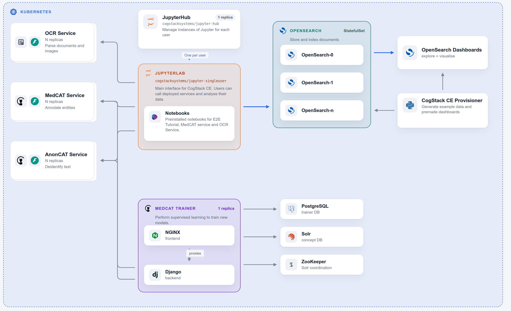

# CogStack CE Architecture

CogStack Community Edition deploys the open source CogStack apps into one Kubernetes release. JupyterHub is the main place you work: each user gets a JupyterLab instance with example notebooks that call the other services over HTTP.

To best explain the architecture, we will first walk through each tutorial use case, and you can see how each service delivers part of the platform. After that, we will add how Trainer and OpenSearch are provisioned as part of the install process.

## How the tutorials connect the services

The tutorials included in CogStack CE all communicate over http to the deployed services. The chart is setup to automatically add environment variables to jupyter to make it easy to use (`OCR_SERVICE_URL`, `MEDCAT_SERVICE_URL`, `ANONCAT_SERVICE_URL`), by creating configmap in kubernetes.

### OCR tutorial

[OCR Service Tutorial](../data-engineering/ocr-service-tutorial.ipynb): Jupyter talks to OCR Service.

The notebook sends scanned images, PDFs, and Word documents to the OCR service `/api/process` endpoint and gets extracted text back. Use this when you need to turn documents or images into text before NLP or search.

### MedCAT service tutorial

[MedCAT Service Tutorial](../platform/cogstack-ai/medcat-service-tutorial.ipynb): Jupyter talks to MedCAT Service and AnonCAT Service.

The notebook sends sample clinical text to:

- MedCAT Service `/api/process` for named entity extraction
- AnonCAT Service `/api/process` for de-identification

Both services are MedCAT deployments: MedCAT annotates concepts, AnonCAT runs in de-identification mode.

### End-to-end tutorial

[MedCAT + OpenSearch end-to-end tutorial](./tutorial/medcat-opensearch-e2e.ipynb): Jupyter talks to MedCAT, then Jupyter talks to OpenSearch.

The notebook:

1. Indexes a sample clinical note in OpenSearch
2. Calls MedCAT Service to extract concepts from that note
3. Indexes the annotations back into OpenSearch
4. Searches the note by free text and by concept

That is the path from unstructured text, through NLP, into searchable data.

For how to open JupyterHub and run these notebooks, see [Using JupyterHub](./tutorial/end-to-end-jupyterhub.md).

## MedCAT Trainer

MedCAT Trainer is included so you can inspect annotations and do supervised learning against the same models the notebooks call.

On startup, CogStack CE auto-provisions Trainer with two example projects. Each project uses a **remote model service** instead of uploading a model pack:

- **Example Project** points at MedCAT Service
- **Example Deid project** points at AnonCAT Service

Trainer sends documents to those services for annotation, so the UI stays aligned with the live CE model endpoints.

See the [MedCAT Trainer provisioning guide](https://docs.cogstack.org/en/latest/nlp/medcat-trainer/provisioning/) for the YAML format and `useModelService` / `modelServiceUrl` options.

Trainer also deploys its supporting stack shown in the diagram: NGINX (frontend), Django (backend), PostgreSQL, Solr, and ZooKeeper.

## OpenSearch Dashboards

OpenSearch stores indexed documents. OpenSearch Dashboards is the UI for exploring and visualising that data.

On install, the CogStack CE provisioner:

- Creates an OpenSearch index template
- Loads example documents
- Imports premade dashboards

The dashboards and data used here were first defined in [cogstack-dashboards-demo](https://github.com/CogStack/cogstack-platform/tree/main/cogstack-dashboards-demo). 

## Architecture Details

### Multiple replicas

Most CogStack services are Kubernetes Deployments, so they can run multiple instances and scale horizontally. They are designed to run in the cluster and be split across multiple nodes / VMs.

OCR Service, MedCAT Service, and AnonCAT Service all are able to scale horizontally, even automatically using a Horizontal Pod Autoscaler. By default we just run 1 instance in the CE.

OpenSearch is a statefulset, so it is able to run multiple instances and should be managed accordingly. By default we run 3 instances in the CogStack CE.

### Helm subcharts

Everything in CogStack CE is deployed as Helm subcharts of the [CogStack CE Helm chart](../platform/deployment/helm/charts/cogstack-ce-helm.md). See the documentation for each chart:

- [MedCAT Service Helm](../platform/deployment/helm/charts/medcat-service-helm.md) (used for both MedCAT and AnonCAT)
- [OCR Service Helm](../platform/deployment/helm/charts/ocr-service-helm.md)
- [MedCAT Trainer Helm](../platform/deployment/helm/charts/medcat-trainer-helm.md)
- [CogStack JupyterHub Helm](../platform/deployment/helm/charts/cogstack-jupyterhub-helm.md)

JupyterHub is based on the [official JupyterHub Helm chart](https://hub.jupyter.org/helm-chart/). OpenSearch and OpenSearch Dashboards also come from the [official OpenSearch Helm charts](https://opensearch-project.github.io/helm-charts/). The CogStack wrappers add defaults, images, and example notebooks on top of those upstream charts.

### Provisioning

Example OpenSearch data and dashboards are created by a Helm post-install hook. That hook runs custom Python defined only in Community Edition to generate synthetic documents, then imports the premade dashboards.

This CE-only provisioner is the `CogStack CE Provisioner` box in the architecture diagram, it runs a standard python image, with custom code mounted as a configmap. The medcat trainer provisioning is handled by trainer itself, as this is a feature of the trainer helm chart and application.

## Next Steps

- View the [CogStack CE Helm chart configuration](../platform/deployment/helm/charts/cogstack-ce-helm.md) for install options and customisation.
- View the cloud deployment examples for running it in [AWS](../platform/deployment/examples/aws-kubernetes-eks.md) or [Azure](../platform/deployment/examples/azure-kubernetes-aks.md)

